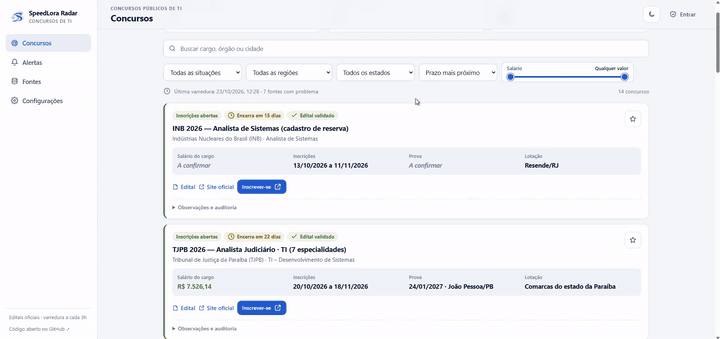

# SpeedLora Radar

[](https://github.com/flemuh/radar-public-sector/actions/workflows/ci.yml)
[](LICENSE)


Monitor de concursos públicos de TI (repositório `radar-public-sector`) a partir de **editais e páginas oficiais**. Um concurso só aparece como confirmado quando o edital oficial foi baixado, contém um cargo de TI e as datas e o salário estão no mesmo documento.

Você pode usar do seu jeito: uma **instância pública** só de leitura para qualquer pessoa, ou uma **instância privada** com login, senha e MFA só para você.




*Demonstração (cerca de 35 s): concursos de TI com status, filtros de salário e estado e acesso ao edital oficial. Cada dado confirmado vem do edital; o que ainda não foi conferido aparece como "não conferido".*

---

## Instalação com Docker

Você precisa de Docker com Compose.

```bash
git clone https://github.com/flemuh/radar-public-sector.git
cd radar-public-sector
cp .env.example .env
```

Edite o `.env` e troque pelo menos:

- `RADAR_PASSWORD`: senha do administrador, com no mínimo 7 caracteres (use uma senha longa e única).
- `RADAR_COOKIE_SECURE`: deixe `0` para testar em `http://localhost`. Atrás de HTTPS, use `1`.

Depois suba os serviços:

```bash
docker compose up -d --build
```

Abra **http://127.0.0.1:8765**. A lista pública aparece; use **Entrar** para o painel de administração.

Para parar sem perder dados: `docker compose down` (nunca use `-v`, que apaga o volume com o banco).

### Testes

```bash
docker build --target test -t radar-tests .
docker run --rm radar-tests
```

---

## Configuração principal (`.env`)

| Variável | Padrão | Para que serve |
|---|---|---|
| `RADAR_PASSWORD` | — | Senha do administrador. Obrigatória. |
| `RADAR_PUBLIC` | `1` | `1`: qualquer pessoa vê a lista. `0`: tudo exige login. |
| `RADAR_APP_NAME` | `SpeedLora Radar` | Nome no site e nos avisos. |
| `RADAR_DEFAULT_UF` | vazio | Estado pré-selecionado na lista (ex.: `SP`). Vazio = Brasil. |
| `RADAR_COOKIE_SECURE` | `1` | `0` só para HTTP local. |
| `RADAR_MFA_ENCRYPTION_KEY` | vazio | Necessária para ativar MFA. Faça backup dela. |
| `RADAR_TRUSTED_PROXIES` | vazio | IPs do seu proxy reverso, para registrar o IP real. |
| `RADAR_RETRY_SECONDS` | `900` | Espera após falha de uma fonte. |
| `RADAR_DOMAIN_INTERVAL_SECONDS` | `8` | Intervalo mínimo entre pedidos ao mesmo site (3 a 60). |
| `SMTP_*`, `ALERT_EMAIL_*` | vazio | Avisos por e-mail (opcional). |
| `TELEGRAM_BOT_TOKEN`, `TELEGRAM_CHAT_ID` | vazio | Avisos por Telegram (opcional). |

As fontes oficiais ficam em **`sources.yaml`**. Cada entrada tem nome, URL oficial, modo e UF. Para desligar uma fonte sem apagá-la, use `enabled: false`. Ao iniciar, o arquivo é validado e erros aparecem com a linha exata.

---

## Como funciona

- **Coleta a cada 3 horas**, em horário de Brasília, com fila por domínio.
- **Respeita o site:** lê `robots.txt` antes de cada página; se o site recusar (403) ou pedir espera (429), o domínio fica pausado pelo tempo indicado. O radar não se disfarça de navegador para passar por bloqueios.
- **Diários oficiais:** concursos de bancas que bloqueiam acesso automático (como a Vunesp) costumam sair no Diário Oficial do município. O radar busca esses diários pela API pública do [Querido Diário](https://queridodiario.ok.org.br/) e mostra o que achar como "a conferir".
- **Validação automática:** o sistema procura o PDF do edital de abertura nas páginas oficiais do concurso e confere cargo, datas e salário sozinho.
- **Validação documental:** o edital é baixado, tem o hash SHA-256 registrado, e o cargo de TI, as datas e o salário precisam aparecer juntos no texto.
- **Extração assistida:** no editor, o botão *Sugerir campos a partir do edital* propõe datas e salário com o trecho de origem. Nada é salvo sem você confirmar.
- **Busca e filtros:** busca sem acento, filtro por estado e ordenação por prazo, salário, órgão ou data.
- **Sua etapa:** no painel, marque se você tem interesse, se inscreveu, se a prova foi marcada ou se aguarda resultado. Essa informação é privada.

**Limite:** a validação é conservadora e não substitui a leitura do edital. PDFs digitalizados ou com texto em anexos podem precisar de revisão manual.

---

## Segurança

- **Senha** com hash scrypt. Troque em *Configurações → Senha do administrador*.
- **MFA opcional** (aplicativo autenticador, com códigos de recuperação).
- **Dispositivos conectados:** veja e encerre sessões de outros navegadores. *Lembrar este dispositivo por 7 dias* dispensa o código MFA só naquele aparelho.
- **Atividade recente:** tentativas de login, troca de senha e mudanças de MFA ficam registradas.
- Em produção, publique apenas via HTTPS com proxy reverso. Não exponha a porta 8765 diretamente.

---

## Atualizar e fazer backup

**Backup do banco** (SQLite, sem parar o serviço):

```bash
docker compose exec concurso-radar python -m app.manage backup
```

Copie o arquivo gerado para fora do servidor. Não inclua `.env` nem a chave MFA nos backups públicos.

**Atualizar:** `git pull && docker compose up -d --build`. Cada tag `vX.Y.Z` publica também a imagem pronta `ghcr.io/flemuh/radar-public-sector` no GitHub, se você preferir não construir localmente. Migrações rodam sozinhas e fazem backup antes de alterar o banco.

**Versão e esquema:** `docker compose exec concurso-radar python -m app.manage version`.

---


## Limites

- **Só fontes oficiais.** Quando um site bloqueia coleta automática (`robots.txt`, 403 ou 429), o radar **não contorna o bloqueio**: ele registra a cobertura parcial na tela *Fontes* e segue para as outras. Por isso a lista é uma amostra, não um censo de todos os concursos do país.
- **Confirmado é raro de propósito.** Só vira "Edital validado" o concurso cujo edital foi baixado, tem cargo de TI e traz datas e salário no mesmo documento. O resto aparece como "A conferir".
- **Sem garantia de cobertura.** Confira sempre o edital oficial antes de se inscrever.

---

## Estrutura

```
app/          backend FastAPI, coleta, validação, migrações
static/       interface (HTML, CSS, módulos JS sem build)
sources.yaml  fontes oficiais monitoradas
tests/        testes automatizados
```

---

## English summary

**SpeedLora Radar** monitors Brazilian public-sector IT job notices from official sources. A notice is marked as confirmed only when the official document was downloaded, contains an IT role, and the dates and salary appear in the same text.

**Run it with Docker:**

```bash
cp .env.example .env        # set RADAR_PASSWORD (7+ chars); RADAR_COOKIE_SECURE=0 for localhost
docker compose up -d --build
# open http://127.0.0.1:8765
```

- **Public mode** (`RADAR_PUBLIC=1`): anyone can browse; only the admin can change anything.
- **Private mode** (`RADAR_PUBLIC=0`): everything requires the admin login.
- Sources live in `sources.yaml`; each can be disabled with `enabled: false`.
- The collector reads `robots.txt`, respects 403/429 responses, and spaces out requests per domain. It never disguises itself to get past a block; contests from blocking organisers are found in municipal official gazettes through the public [Querido Diário](https://queridodiario.ok.org.br/) API.
- Optional MFA, device/session management, and email or Telegram alerts (use *Send test alert* in Settings).
- Tests: `docker build --target test -t radar-tests . && docker run --rm radar-tests`.
- Every `vX.Y.Z` tag also publishes a ready-made image to `ghcr.io/flemuh/radar-public-sector`.

**Limits:** the validation is conservative and does not replace reading the official notice. Scanned PDFs may need manual review.

---

Licença: veja [LICENSE](LICENSE).
